<div align="center">

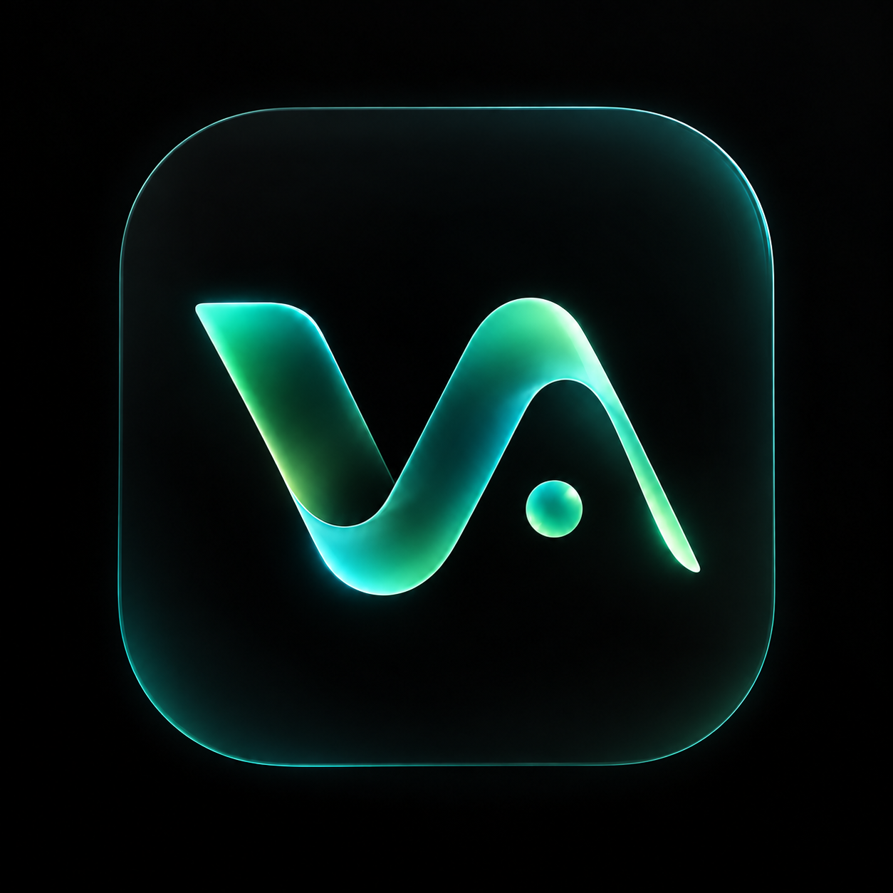

# VibeArc

**Your music, your space. Available for Android & Android TV.**

A native Android & Android TV music player with liquid glass, artwork-driven colors, synchronized lyrics, and optional YouTube Music connectivity.

<p align="center">
  <a href="https://github.com/smithcooks/VibeArc/stargazers"></a>
  <a href="https://github.com/smithcooks/VibeArc/forks"></a>
  <a href="#connected-features"></a>
  <a href="#downloads--installation"></a>
</p>

<p align="center">
  <a href="https://github.com/smithcooks/VibeArc/releases/tag/v2.0.1"></a>
  <a href="#tech-stack--architecture"></a>
  <a href="LICENSE"></a>
</p>

<p align="center">
  <a href="https://github.com/smithcooks/VibeArc/releases/download/v2.0.1/VibeArc-v2.0.1-arm64.apk"></a>
  &nbsp;
  <a href="https://github.com/smithcooks/VibeArc/releases/download/v2.0.1/VibeArc-TV-v2.0.1-arm64.apk"></a>
  &nbsp;
  <a href="https://smithcooks.github.io/VibeArc/"></a>
  &nbsp;
  <a href="https://github.com/smithcooks/VibeArc/issues"></a>
</p>

<p align="center">
  <a href="https://buymeachai.ezee.li/Smith_cooks"></a>
  &nbsp;
  <a href="https://github.com/sponsors/smithcooks"></a>
</p>

<sub>Support is optional. GitHub Sponsors is not active yet; its button currently opens Smith’s GitHub profile.</sub>

</div>

<br>

##  Product Showcase

<div align="center">
  <a href="docs/screenshots/vibearc_banner_clean.png">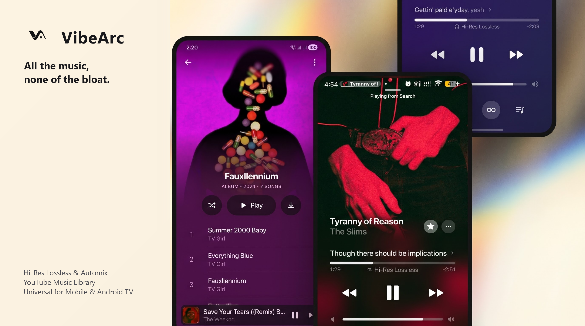</a>
  <p><sub>Real UI capture: Liquid Glass design, artwork-driven color palette, synchronized lyrics with Hi-Res lossless playback, and queue management.</sub></p>
</div>

<br>

##  Android TV Experience

VibeArc is now fully optimized for your living room with a dedicated **Android TV Edition**. Engineered specifically for 10-foot viewing and directional remote controls (D-pads), you get the same fluid liquid-glass interface and synchronized lyrics directly on your big screen.

<div align="center">
  <a href="docs/screenshots/tv_now_playing.png">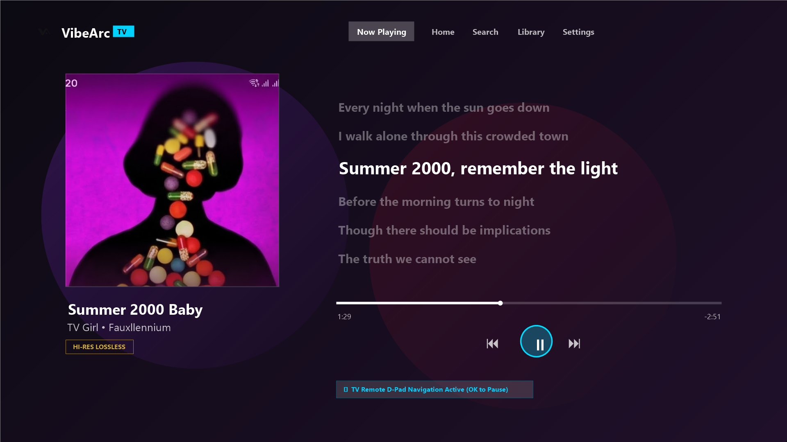</a>
  <p><sub>VibeArc TV: 16:9 landscape playback with glowing D-pad focus ring, real-time synchronized lyrics, full album sleeve, and media transport controls.</sub></p>
</div>

### Built for the Big Screen & Remote Control:
- **Spatial D-Pad Navigation**: Seamless navigation across navigation tabs, search pills, mini-player, track rows, and dialogs with tactile spring animations and an illuminated cyan focus ring.
- **Hardware Remote Media Keys**: Instant control for `Play`, `Pause`, `Play/Pause`, `Next`, `Previous`, `Rewind`, and `Fast-Forward` straight from your TV remote.
- **TV-Optimized YouTube Login**: Log in to YouTube Music on your TV with directional remote navigation and on-screen keyboard support.
- **Ultra-Lightweight (<60 MB)**: Standalone TV APK builds are under 60 MB for quick installation on Android TV, Google TV, and streaming sticks.
- **Android TV Leanback Launcher**: Features a dedicated 16:9 high-definition banner for your TV home screen.
- **Automated In-App Updates**: Dedicated TV update channel that checks, verifies SHA-256 checksums, and installs new TV releases directly inside the app.

<br>

##  Mobile Screenshots Gallery

<div align="center">
  <a href="docs/screenshots/mobile_now_playing.png">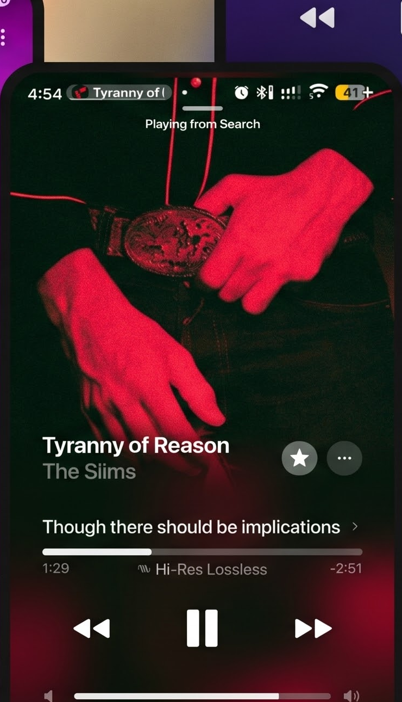</a>
  <a href="docs/screenshots/mobile_album_view.png">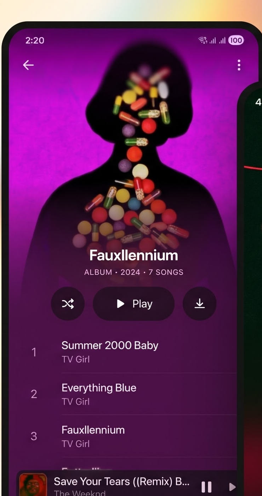</a>
  <a href="docs/screenshots/home.jpg">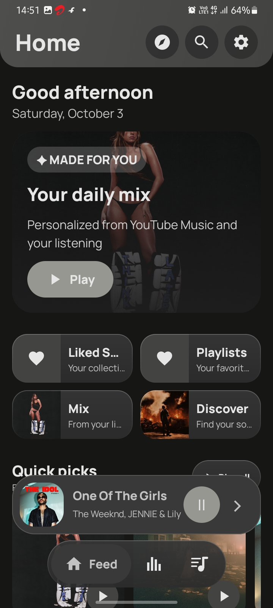</a>
  <br><br>
  <a href="docs/screenshots/search.jpg">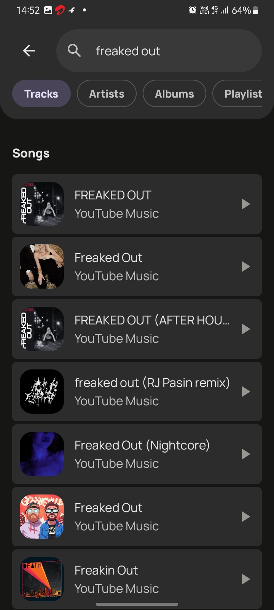</a>
  <a href="docs/screenshots/library.jpg">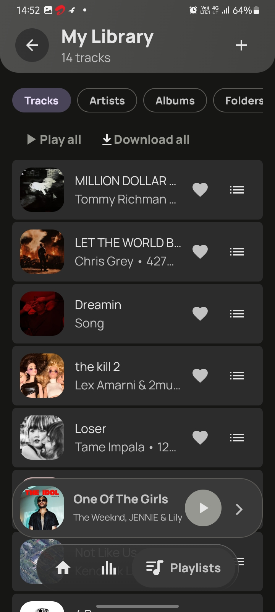</a>
  <a href="docs/screenshots/discovery.jpg">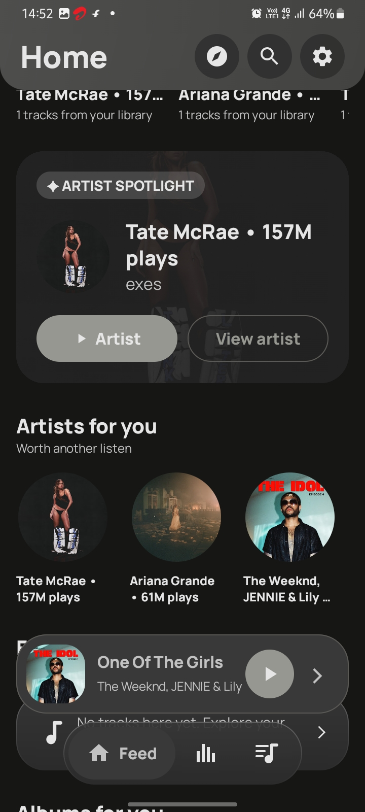</a>
  <br><br>
  <a href="docs/screenshots/appearance.jpg">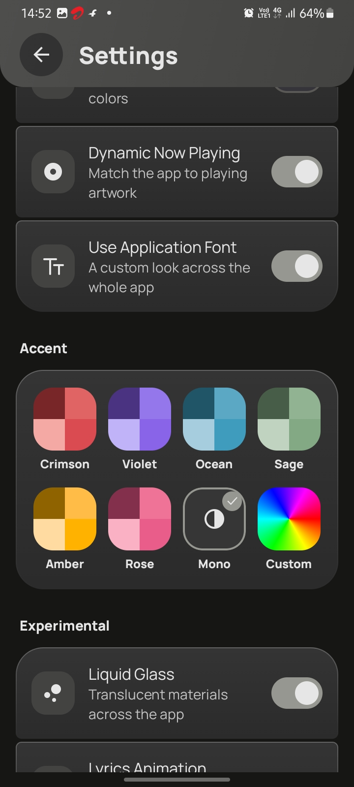</a>
  <a href="docs/screenshots/accounts.jpg">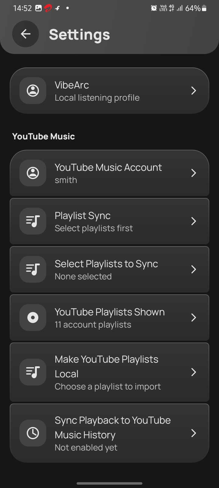</a>
  <a href="docs/screenshots/about.jpg">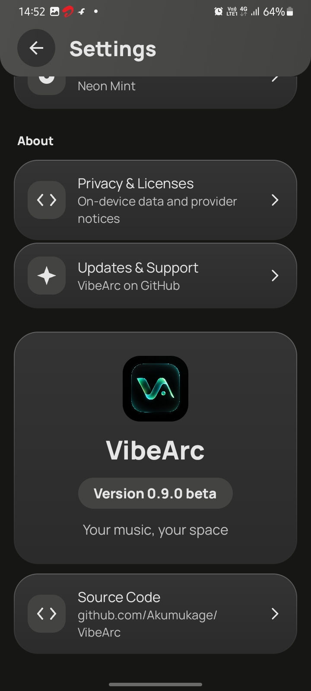</a>
  <p><sub>Authentic screenshots captured from VibeArc. Unaltered app UI. Click any screenshot to view in full resolution.</sub></p>
</div>

<br>

##  What's New in v2.0.1

- **Dedicated Android TV Edition:** Separate TV build (`com.vibearc.app.tv`) with complete Leanback launcher support, remote D-pad focus indicators, and TV banner artwork.
- **Full TV Remote Control:** Native handling for standard D-pad buttons and media remote keys (`Play`, `Pause`, `Next`, `Previous`, `Rewind`, `Fast Forward`).
- **YouTube Music TV Login:** WebView session optimized for D-pad focus and remote navigation to connect your account smoothly on TV.
- **Dual-Platform In-App Updates:** Smart updater that detects whether you are on mobile or Android TV and automatically retrieves and verifies the correct release package.
- **Under 60 MB TV APK:** Highly optimized asset packaging keeping the TV edition between 51 MB – 60 MB.
- **Liquid Glass & Folding Navigation:** Refined responsive liquid-glass navigation bar and immersive Now Playing animations.
- **Full Spotify Playlist Importer:** Import public Spotify playlists directly with full pagination and track matching.
- **High-Fidelity Audio:** Retains original Opus audio via WebM by default, with optional on-device 320 kbps LAME MP3 conversion.

<br>

<a id="downloads--installation"></a>

##  Downloads & Installation

All release APKs are signed with the official release key and include SHA-256 checksums for in-app and manual verification.

### 📱 Android Phone & Tablet
| Package | Architecture | Size | Download Link | Checksum |
| :--- | :--- | :--- | :--- | :--- |
| **VibeArc Mobile (arm64)** *(Recommended)* | 64-bit ARM | ~57.7 MB | [**Download APK**](https://github.com/smithcooks/VibeArc/releases/download/v2.0.1/VibeArc-v2.0.1-arm64.apk) | [SHA-256](https://github.com/smithcooks/VibeArc/releases/download/v2.0.1/VibeArc-v2.0.1-arm64.apk.sha256) |
| **VibeArc Mobile (Universal)** | All devices (32 & 64-bit) | ~83.9 MB | [**Download APK**](https://github.com/smithcooks/VibeArc/releases/download/v2.0.1/VibeArc-v2.0.1.apk) | [SHA-256](https://github.com/smithcooks/VibeArc/releases/download/v2.0.1/VibeArc-v2.0.1.apk.sha256) |

### 📺 Android TV, Google TV & Streaming Devices
| Package | Architecture | Size | Download Link | Checksum |
| :--- | :--- | :--- | :--- | :--- |
| **VibeArc TV (Universal)** *(Recommended)* | **All Android TV 12+ devices** (32 & 64-bit) | ~80.1 MB | [**Download APK**](https://github.com/smithcooks/VibeArc/releases/download/v2.0.1/VibeArc-TV-v2.0.1.apk) | [SHA-256](https://github.com/smithcooks/VibeArc/releases/download/v2.0.1/VibeArc-TV-v2.0.1.apk.sha256) |
| **VibeArc TV (armeabi-v7a)** | 32-bit (Fire TV Stick, Mi Box, Chromecast HD) | ~49.1 MB | [**Download APK**](https://github.com/smithcooks/VibeArc/releases/download/v2.0.1/VibeArc-TV-v2.0.1-armeabi-v7a.apk) | [SHA-256](https://github.com/smithcooks/VibeArc/releases/download/v2.0.1/VibeArc-TV-v2.0.1-armeabi-v7a.apk.sha256) |
| **VibeArc TV (arm64)** | 64-bit (Nvidia Shield, Bravia XR, Chromecast 4K) | ~57.7 MB | [**Download APK**](https://github.com/smithcooks/VibeArc/releases/download/v2.0.1/VibeArc-TV-v2.0.1-arm64.apk) | [SHA-256](https://github.com/smithcooks/VibeArc/releases/download/v2.0.1/VibeArc-TV-v2.0.1-arm64.apk.sha256) |

> [!TIP]
> Existing installed versions will automatically detect this update and notify you directly within the app. You can also manually trigger an update check anytime via **Settings → About & Support → Check for Updates**.

---

##  Key Features

| Icon | Feature | Highlight |
| :---: | :--- | :--- |
|  | **Android TV Support** | Dedicated 10-foot UI with D-pad navigation, remote media keys, and Leanback launcher integration. |
|  | **YouTube Music client** | Search tracks, artists, albums, and playlists; connect an account and import playlists through an experimental integration. |
|  | **Your library & queue** | Browse tracks, artists, albums, and folders. Long-press to like, queue, save to a playlist, or download. |
|  | **Synchronized lyrics** | Line highlighting, timed words when supplied, manual matching/editing, timing offsets, and `.lrc` export. |
|  | **Offline downloads** | Save playable online songs using the tested playback downloader. Browse, search, filter, and export your offline collection. |
|  | **Discovery & radio** | Browse mixes, artist spotlights, recommendations, and radio from available provider and listening data. |
|  | **Make it yours** | Artwork-driven accents, wallpaper colors, AMOLED mode, optional liquid glass, custom fonts, and launcher icons. |
|  | **Playback controls** | Background playback, lock-screen controls, shuffle, repeat, sleep timer, audio tuning, and crossfade where supported. |
|  | **Home-screen widgets** | Seven glass-style designs with artwork, playback controls, compact layouts, and a synchronized lyric card. |
|  | **In-app updates** | Download verified stable-release APKs directly with SHA-256 checksum verification and Android-approved installation. |
|  | **Backup & restore** | Export and restore local data through JSON backups; account credentials are excluded. |

---

<a id="connected-features"></a>

##  Connected Features

**YouTube Music** uses an unofficial, experimental in-app WebView session, not official Google OAuth. Cookies stay in the device’s WebView session. Supported playlist synchronization is manually reviewed and confirmed. Automatic background sync and YouTube playback-history submission are **not implemented**. Provider changes, regional restrictions, and verification challenges can interrupt access.

Listening history and library statistics stay on the device. Last.fm sign-in, profile/radio requests, and scrobbling are no longer included.

**Lyrics** use LRCLIB, a SimpMusic video-ID fallback, KuGou KRC, and Lyrics.ovh. Availability varies by recording; word highlighting needs word timestamps. Manual matching and offsets help when automatic results are imperfect.

<details>
<summary><strong>Downloads, audio quality, and device limitations</strong></summary>

- Download only music you own or have permission to save, and respect provider terms.
- WebM is the default and retains the original available Opus audio. Optional MP3 conversion uses native LAME on the device; 320 kbps encoding does not improve the source or create lossless/Hi-Res audio. A missing WebM source is reported, never silently renamed from AAC/MP4.
- The 15-band equalizer uses DynamicsProcessing on supported Android 9+ devices. Audio effects depend on Android and your hardware.
- Studio Master is a tuning preset, not a quality certification. Lossless sources do not guarantee bit-perfect or Hi-Res device output.
- Discovery results depend on provider data and account setup, not guaranteed complete personalization.

</details>

---

<a id="tech-stack--architecture"></a>

##  Tech Stack & Architecture

- **Language & UI:** Kotlin · Jetpack Compose · Material 3
- **Platforms:** Android (Phone & Tablet) · Android TV / Google TV
- **Audio engine:** AndroidX Media3 / ExoPlayer
- **Online sources:** Experimental YouTube Music client · NewPipeExtractor
- **Lyrics:** LRCLIB · SimpMusic · KuGou KRC · Lyrics.ovh
- **Project layout:** Android app in `app/`, launch website in `docs/`, checks in `tools/`, implementation notes in `tasks/`

---

<a id="getting-started"></a>

##  Getting Started

1. Download the APK corresponding to your device:
   - For Android Phones/Tablets: [**VibeArc-v2.0.1-arm64.apk**](https://github.com/smithcooks/VibeArc/releases/download/v2.0.1/VibeArc-v2.0.1-arm64.apk)
   - For Android TV / Google TV: [**VibeArc-TV-v2.0.1-arm64.apk**](https://github.com/smithcooks/VibeArc/releases/download/v2.0.1/VibeArc-TV-v2.0.1-arm64.apk)
2. Allow installation for the browser or file manager you used, then install on **Android 8.0+ (API 26)**.
3. Add local music or explore compatible online sources.
4. Choose your accent, build your queue, and press play.

Export a JSON backup before updating. Existing versions with the in-app updater can get this release from **Settings → About & Support**. Sideloading warnings may appear; VibeArc is not a Google Play listing or Play Protect certification.

---

##  Building from Source

Requirements: **JDK 21**, Android SDK **36**, Build Tools **36.0.0**, and the included Gradle **8.14.3** wrapper. Configure the SDK in Android Studio or an untracked `local.properties`.

```powershell
git clone https://github.com/smithcooks/VibeArc.git
cd VibeArc

# Build Mobile APK
.\gradlew.bat :app:assembleRelease

# Build Android TV APK
.\gradlew.bat :app:assembleTvRelease

# Run unit tests and lint
.\gradlew.bat :app:testDebugUnitTest :app:lintRelease
```

On macOS/Linux, use `./gradlew` instead of `.\gradlew.bat`. Release builds require your own untracked `keystore.properties` and keystore. Signing keys and credentials are not distributed.

---

##  Community & Support

- **Website:** [Explore VibeArc](https://smithcooks.github.io/VibeArc/)
- **Updates:** [Releases](https://github.com/smithcooks/VibeArc/releases) · [Changelog](CHANGELOG.md)
- **Feedback:** [Report a bug or suggest an improvement](https://github.com/smithcooks/VibeArc/issues)
- **Support Smith:** [Buy Me a Chai](https://buymeachai.ezee.li/Smith_cooks) · [GitHub Sponsors](https://github.com/sponsors/smithcooks) (not active yet)

Include your device model, Android version, reproduction steps, and a public song link if relevant. **Never share account cookies, session tokens, or API secrets.** Focused pull requests and device-testing feedback are welcome.

---

##  Privacy, License & Attribution

No advertising or analytics SDKs. Library and preferences stay locally; connected services receive requests for their features. Android cloud backup is disabled. Read the [privacy notice](PRIVACY.md), [GPL v3 license](LICENSE), and [third-party notices](THIRD_PARTY_NOTICES.md).

VibeArc’s UI and this README’s layout are inspired by [LastWave](https://github.com/Clash-Projects/LastWave-Native). VibeArc is an independent project, with its own screenshots, branding, and feature documentation.

> [!NOTE]
> VibeArc is not affiliated with or endorsed by Google, YouTube Music, Last.fm, or any other music service. Online integrations remain experimental. Use content only with the appropriate permission and follow provider terms. Album artwork in the screenshots belongs to its respective owners.

---

<div align="center">
  <p><b>VibeArc</b> is built with ❤️ by <a href="https://github.com/smithcooks">Smith</a>.</p>
</div>
